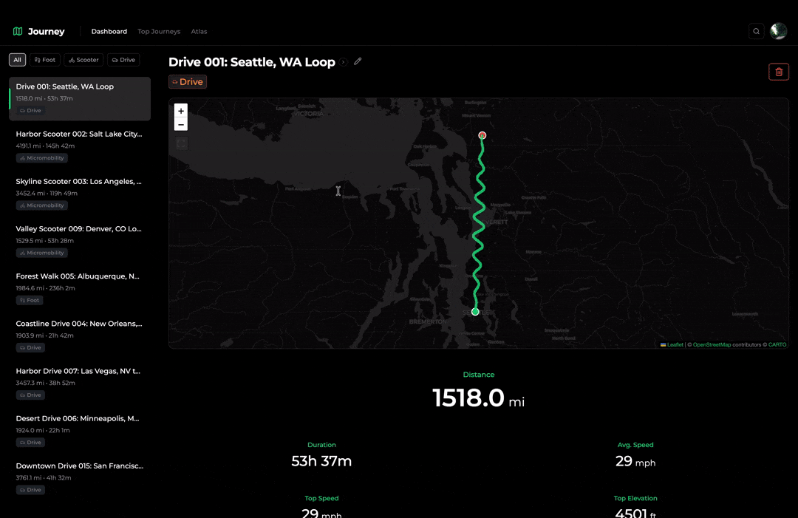

# Journey

**The first-class timeline platform.**

Journey is a self-hosted location tracking and analytics platform that lets you record your travels, explore past trips, and see everywhere you've been on a map.

## What can Journey do?

Journey records GPS data from an iPhone or Apple Watch and brings everything together in a web dashboard.

Some of its main features include:

- **Trip tracking:** Record your routes along with distance, speed, elevation, duration, and waypoints.
- **Interactive maps:** Explore individual trips, inspect GPS points, and see exactly where you've traveled.
- **Atlas:** View your entire travel history on one map, with route overlays and a heatmap showing your most frequently visited areas.
- **Travel stats:** Look back at your longest journeys, fastest trips, elevation changes, and other statistics.
- **Automatic travel detection:** Identify whether a journey was made on foot, by bike or other micromobility, or by vehicle.
- **Photos and videos:** Attach memories to individual trips so you can revisit more than just the route.
- **Journey management:** Rename, organize, combine, and edit recorded trips.

Journey doesn't include advertising trackers or application telemetry. Some optional features and map services still make requests to external providers (like weather), but your complete travel history isn't sent to a third-party tracking platform.

## How it works

- Journey consists of a few connected parts:
- The iPhone and Apple Watch apps handle location recording, collecting GPS coordinates and other information throughout a trip.
- The backend receives and processes those recordings, calculates trip statistics, and stores everything in PostgreSQL.
- The web dashboard is where you explore your history (you can also do it via iOS app). You can view individual routes, compare trips, manage photos, and use Atlas to see all your journeys together.

## Documentation

- Getting started: [`documentation/GETTING_STARTED.md`](documentation/GETTING_STARTED.md)
- Docs index: [`documentation/README.md`](documentation/README.md)

## Tech Stack

- Frontend: React + Vite
- Backend: Node.js + Express
- Database: PostgreSQL

## Project Status

- Journey is an ongoing personal project. Initially I built this because existing solutions like Google Timeline were either too buggy or too complicated to use. Or maybe they didn't fulfill the web component part. Either way, I'm continuing to work on its features, performance, and overall experience, such as processing GPS data, mapping, and making it easier to explore years of location history. I think Journey will be interesting as time goes on.
- Ultimately, I want Journey to be a place where you can open a map, look back at anywhere you've traveled, and remember the experiences behind those routes.
