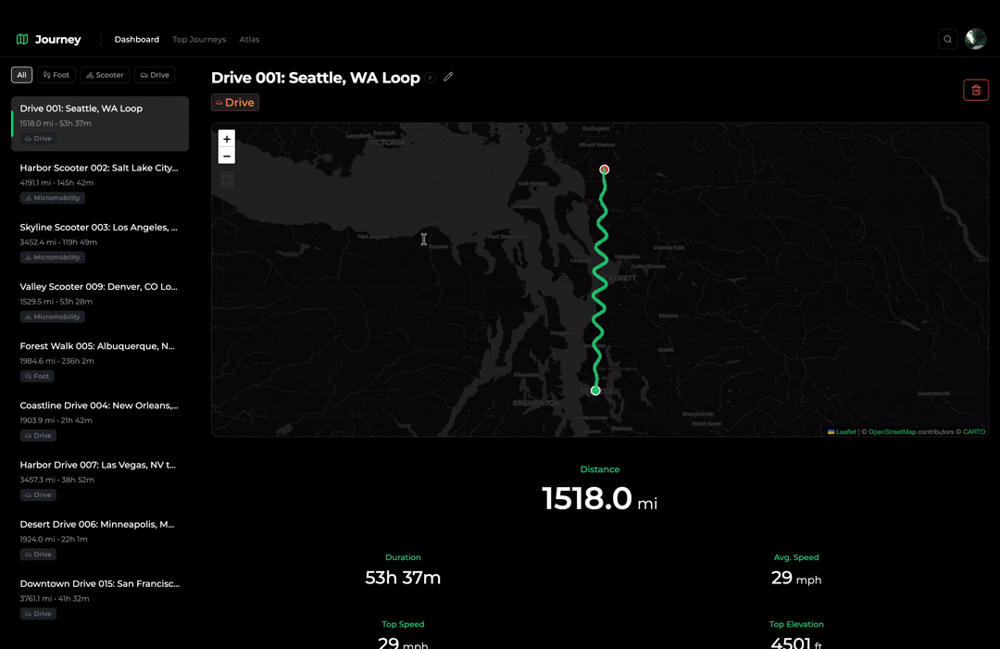

# Journey

**The first-class timeline platform.**

Journey is a privacy-first travel history and analytics platform that tracks
where you’ve been and visualizes your movement.

## What Journey Does

- Records high-fidelity data from your phone or Apple Watch (GPS, elevation, speed, waypoints)
- Maps each trip with interactive routes (hovering over points, etc.)
- Detects travel mode automatically (foot, micromobility, drive)
- Lets you attach photos as memory layers to each route
- Includes all-time Atlas views (line map + heatmap)

## Privacy-First by Design

- Your data stays on your server
- Weather is looked up for the city a journey starts in, never your exact location
- Zero telemetry, no tracking scripts

## Documentation

- Getting started: [`documentation/GETTING_STARTED.md`](documentation/GETTING_STARTED.md)
- Docs index: [`documentation/README.md`](documentation/README.md)

## Tech Stack

- Frontend: React + Vite
- Backend: Node.js + Express
- Database: PostgreSQL
